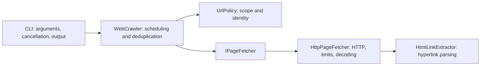

# Zego web crawler — C#

A command-line crawler for the [Zego engineering exercise](https://github.com/Zegocover/engineer-hiring-tech-exercise/blob/main/python/README.md). C# is permitted by the recruitment email. Given an initial HTTP(S) URL, it visits hyperlinks on the exact same host and prints each visited URL and its discovered links. External links remain visible but are not visited.

## Run

Requirements: .NET 10 SDK (10.0.100 or a newer stable 10.0 feature band, as allowed by `global.json`). All projects target `net10.0`; installing the SDK supplies the runtimes needed for the CLI, HTTP integration tests and measurement harness. Visual Studio users need a version with .NET 10 support. No browser, Python or database is required. Restore needs NuGet access.

```sh
dotnet restore Zego.Crawler.sln --locked-mode
dotnet build Zego.Crawler.sln --configuration Release --no-restore
dotnet run --project src/Zego.Crawler.Cli --configuration Release --no-build -- https://example.com/
```

Custom limits:

```sh
dotnet run --project src/Zego.Crawler.Cli --configuration Release --no-build -- https://example.com/ --concurrency 4 --max-pages 10000 --max-response-bytes 2097152 --timeout-seconds 15
```

All option values must be positive integers. Unknown/duplicate options, invalid URLs and embedded credentials are rejected. `--help` prints usage.

| Option | Default | Meaning |
| --- | --- | --- |
| `--concurrency` | 4 | Maximum outstanding fetch tasks and connections per server |
| `--max-pages` | 10000 | Maximum distinct URLs scheduled, including redirects and non-HTML resources |
| `--max-response-bytes` | 2097152 | Maximum decompressed HTML response bytes |
| `--timeout-seconds` | 15 | Per-fetch timeout covering headers, body and parsing |

Page blocks go to stdout; errors and the final summary go to stderr:

```text
PAGE https://example.com/
  STATUS Success (200)
  LINK https://example.com/about
  LINK https://external.example/page

PAGE https://example.com/about
  STATUS Success (200)

```

This is illustrative output, not a claim about the contents of example.com. Links within a page are unique and sorted. Page order follows completion order and may vary. Output is written by the coordinator, so blocks do not interleave. Redirect blocks show the `Location` URL; failures and skipped resources also produce a block with their status.

| Exit code | Meaning |
| --- | --- |
| 0 | All scheduled pages processed without failures or omitted eligible URLs |
| 1 | One or more page failures, page limit omitted work, or output failure |
| 2 | Invalid command line |
| 130 | Caller cancellation/Ctrl+C; output may be partial |

A non-HTML response is intentionally skipped rather than treated as an HTTP failure. Resource/timeout failures make the crawl incomplete; a page limit is only reported as reached if it actually prevents scheduling a new eligible URL.

## Contract and assumptions

The brief leaves some URL semantics unspecified. This implementation makes them explicit:

- **Links mean HTTP(S) navigation hyperlinks:** `a[href]` and `area[href]`. Images, scripts, forms, CSS URLs, `srcset`, `mailto:`, `tel:` and JavaScript links are outside this interpretation. Expanding “all URLs” to include assets is an extractor change and should be clarified with reviewers; this implementation does not claim to enumerate every URL-bearing HTML attribute.
- **Scope means the exact IDN-normalized host**, compared without case. `example.com` does not include `www.example.com`, other subdomains or lookalike suffixes. HTTP/HTTPS and different ports on that host are allowed: the brief restricts domains, not origins. The initial URL is subject to the same rules as subsequent URLs.
- **Identity removes fragments**, normalizes host/scheme/default ports through `System.Uri`, and preserves path case, trailing slashes and query values/order. Potentially distinct query variants are not merged. Printed links retain their fragments; fetch identities do not.
- **Relative hyperlinks resolve against the page URL**, using the first `base[href]` if it resolves to an allowed HTTP(S) URL. An unsupported first base falls back to the page URL; later base elements do not override it. An external base affects link resolution, never crawl scope.
- **Redirects are graph edges.** Automatic HTTP redirects are disabled. The coordinator schedules a valid destination only if in scope and not already scheduled. This avoids fetching a redirect destination twice when another page links directly to it and terminates cycles without a separate redirect-depth counter. Redirects outside scope are printed but not followed. A missing/invalid HTTP(S) location is a page failure.
- **HTML is server-rendered content only.** No scripts execute and no assets are loaded by the parser. HTML and XHTML MIME types are accepted; missing/other content types are skipped. Non-success HTTP responses are failures and their bodies are not crawled.
- **Decoding uses HTTP charset**, with BOM detection; UTF-8 is the fallback. Unsupported encodings are reported. HTML-only `meta charset` declarations are not used to override the decoding choice; this is a known limitation for legacy pages without a correct HTTP charset.
- **No silent truncation:** oversized bodies fail visibly; omitted eligible URLs set a summary flag and exit code 1. Existing work continues after individual page failures. Pages are not retried by the crawler.

## Architecture

Files and namespaces are grouped by responsibility. Entry points and project configuration remain at project roots:

```text
src/
  Zego.Crawler/
    Crawling/       # Coordinator, options, fetch contract and result types
    Http/           # HTTP adapter and response limits
    Parsing/        # HTML hyperlink extraction
    Urls/           # Scope and URL identity rules
  Zego.Crawler.Cli/
    Arguments/      # Argument parsing and validation
    Execution/      # Application execution and console output
    Program.cs      # Composition and Ctrl+C handling
tests/
  Zego.Crawler.Tests/
    Unit/
      Arguments/
      Crawling/
      Parsing/
      Urls/
    Integration/   # Real HTTP and complete CLI flows
    TestSupport/   # Controlled fetcher and loopback server
tools/
  Zego.Crawler.Benchmarks/
    Measurements/  # Trial result type
    Program.cs     # Measurement harness entry point
```

Folders make existing responsibilities easier to navigate; they do not introduce additional runtime layers. Each top-level declared type has its own file, and namespaces match their containing folders.



`Zego.Crawler` contains the reusable crawling logic; `Zego.Crawler.Cli` owns the user interaction. `IPageFetcher` is the I/O seam, implemented by the HTTP fetcher and controlled test adapters. Pure URL rules and HTML extraction can be tested without networking. Results are returned as values and delivered through a callback, allowing streaming output without retaining the whole crawl graph.

The single coordinator owns the pending queue, scheduled identities and active tasks. It records a URL **before** dispatch, starts at most N fetches, processes one completed result and schedules newly discovered links. No locks are needed around crawling state. It finishes only when both the pending queue and active task set are empty. Run-specific state is local; the HTTP adapter reuses one connection pool for the crawl.

Caller cancellation is propagated. Per-page timeouts become failure results, so independent pages can continue. On cancellation or an output error, outstanding tasks are cancelled and observed before returning. Unexpected programming errors propagate rather than being converted into successful output.

### Why a modular design rather than full Clean Architecture?

This solution deliberately uses a small modular design. The current requirement is a CLI that traverses a website; it has no substantial business domain, persistence workflow or independently deployed application modules. Separate Domain, Application and Infrastructure projects would add project references and navigation overhead with little additional isolation for this scope.

The useful principles still apply: responsibilities are separated, dependencies are supplied explicitly, and the coordinator depends on the `IPageFetcher` abstraction rather than on `HttpPageFetcher`. Production uses the HTTP adapter; coordinator tests use a controlled adapter through the same interface. URL rules and HTML extraction have focused test surfaces. Additional interfaces are introduced only where there is a concrete need to vary behaviour.

This separation is logical, not a claim of fully enforced Clean Architecture: crawling logic, HTTP and parsing live in the same library assembly, which references AngleSharp. The folder structure improves navigation but does not enforce assembly-level dependency rules. The CLI assembles the application and owns its arguments, cancellation signal and output.

The trade-off is less structural enforcement in exchange for a smaller solution that is easier to understand and change. I would revisit project-level separation if independently reusable modules, persistent jobs, richer business rules or multiple execution environments created a concrete need to enforce dependency direction. An additional entry point alone would not automatically justify a full architectural rewrite. The aim is to keep the design proportional to the requirements while preserving testability and clear responsibilities.

### Alternatives and trade-offs

- Sequential traversal is simpler but leaves I/O capacity unused. Unbounded `Task.WhenAll` or one task per discovered URL can accumulate excessive tasks; the coordinator limits dispatch itself.
- A worker/channel design can be appropriate for a larger service. In this recursive producer/consumer workload, bounded channels require careful termination and backpressure design to avoid every worker waiting to enqueue. A single coordinator is easier to reason about for this CLI.
- `HttpClient` is reused rather than constructed per request. Its handler disables automatic redirects and cookies, limits connections, supports decompression and periodically refreshes pooled connections. `ResponseHeadersRead` and a streaming byte limit avoid unbounded body buffering, including decompression expansion.
- AngleSharp supplies tolerant HTML parsing, avoiding regex-based HTML extraction. It is the only direct application package. It does not perform navigation. Tests use xUnit and a Kestrel loopback fixture supplied by the shared ASP.NET Core framework; production has no ASP.NET dependency.
- Sorting only each page's links provides readable output without buffering all page results for a globally deterministic order. Choosing globally sorted output would delay results and retain more memory.
- The interface is deliberately small. Responsibilities and an actual I/O seam provide extensibility without speculative abstraction.

### Resource characteristics

For P scheduled pages, concurrency C, body cap B and L hyperlinks on a page:

- The pending queue and scheduled set hold at most P entries; active fetch tasks are bounded by C. P itself is bounded by `--max-pages`.
- A response retains its byte buffer, decoded text, DOM and links during processing. Memory scales with C and B, plus URL lengths and parsing overhead; B is **not** a total-memory cap. Completed results can temporarily be retained by the bounded active task set.
- Expected hash-based identity lookups are constant time. Link deduplication/sorting costs approximately O(L log L). Parsing is proportional to bounded HTML input, while DOM structure and allocations affect actual cost.
- `Task.WhenAny` bookkeeping scales with C. This is appropriate for modest configurable concurrency, not a claim that millions of parallel fetches would be efficient.

The practical choice is modest concurrency with visible limits.

## Tests and checks

```sh
dotnet test Zego.Crawler.sln --configuration Release --no-build --no-restore
dotnet format Zego.Crawler.sln --verify-no-changes --no-restore
```

Tests cover exact-host scope and IDN identity, relative/base links, fragments and query variants, cycles, simultaneous discovery, bounded concurrency, completion while work is in flight, page limits, partial failures, cancellation and output failures. Integration tests use real HTTP on OS-assigned loopback ports, including external redirects, redirect cycles, missing locations, broken connections, MIME filtering, declared encodings, timeouts during body reading and oversized streamed/compressed responses. Unit concurrency tests use explicit gates rather than sleep-based ordering. External sites are not test dependencies.

Package versions and transitive dependencies are recorded in committed `packages.lock.json` files. Nullable analysis, SDK analyzers and warnings as errors are enabled. CI performs locked restore, Release build, tests and formatting checks on Windows and Linux. CI is configured but has not run on GitHub; local validation is recorded in [validation.md](docs/validation.md).

## Performance measurement

```sh
dotnet run --project tools/Zego.Crawler.Benchmarks --configuration Release --no-build
```

The harness serves 41 pages locally, with 25 ms of deliberate latency on each of 40 child pages and links back to the root. It warms up each configuration, then alternates five measured crawls at concurrency 1 and 4. Every trial checks the page count, absence of failures, one request per URL and the concurrency limit. It reports elapsed time, median and peak server requests as JSON. Each crawl has a fresh client, like a separate CLI invocation.

Measured results and their interpretation are in [performance.md](docs/performance.md), with raw trials in [performance-results.json](docs/performance-results.json). This demonstrates behaviour under a controlled I/O workload. It does not establish performance on arbitrary websites or a peak-memory bound; server throttling, response size, parsing cost and stdout speed can change the result.

## Limitations and next steps

There is no JavaScript rendering, robots.txt implementation, per-host pacing, retry/backoff policy, authentication, persistent frontier or resume. These are explicit scope choices, not claims of a full production crawler. Robots policy and politeness would need agreement before broader operational use. A service accepting URLs from untrusted users would also need network access controls and isolation.

For multiple domains, separate visit policies and scheduling budgets per host while retaining shared fetch logic. For a hosted API, add job identity, result storage, cancellation, access control and quotas. For restart recovery, persist scheduled/completed state and make reprocessing idempotent. More sophisticated encoding sniffing and resource-link extraction belong in the parser/decoding modules.

The solution targets **.NET 10 LTS**, whose [support lifecycle](https://dotnet.microsoft.com/en-us/platform/support/policy/dotnet-core) runs until 14 November 2028. This avoids starting a new project on .NET 9 shortly before its support ends on 10 November 2026. `global.json` accepts stable SDK updates within .NET 10 while preventing an automatic switch to a future major SDK. CI uses .NET 10 on both Windows and Linux; validation results identify which environments have actually been tested.

## Tools and AI disclosure

The development workflow used **Visual Studio** and **OpenAI Codex**, with Bruno directing the work as the human in the loop. Bruno made the architectural and implementation decisions, reviewed the code, challenged proposed approaches and determined the next steps. Codex was used as an agentic development assistant under that direction.

Codex assisted with implementation, test creation, refactoring, investigation, performance measurements and documentation. Its proposals were subject to human review and decisions rather than accepted automatically. Examples of Bruno's direction included establishing the quality criteria, requesting clearer project organisation, examining the scope of CLI options and challenging the architectural and performance trade-offs.

PowerShell and the .NET CLI were used to restore dependencies, build, format, run tests and execute the measurement harness. Research used primary sources, including the official exercise, Microsoft documentation, NuGet metadata and the AngleSharp repository. The observed validation results and their limits are recorded in [validation.md](docs/validation.md) and [performance.md](docs/performance.md).
